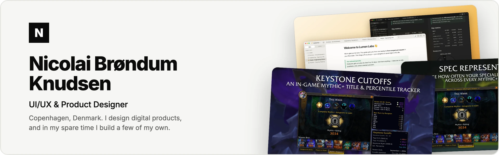
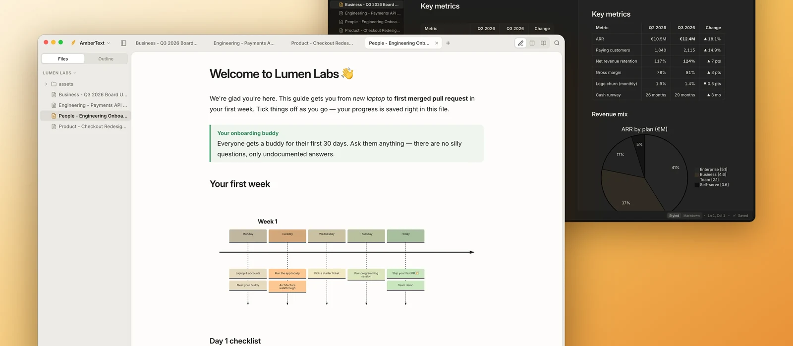
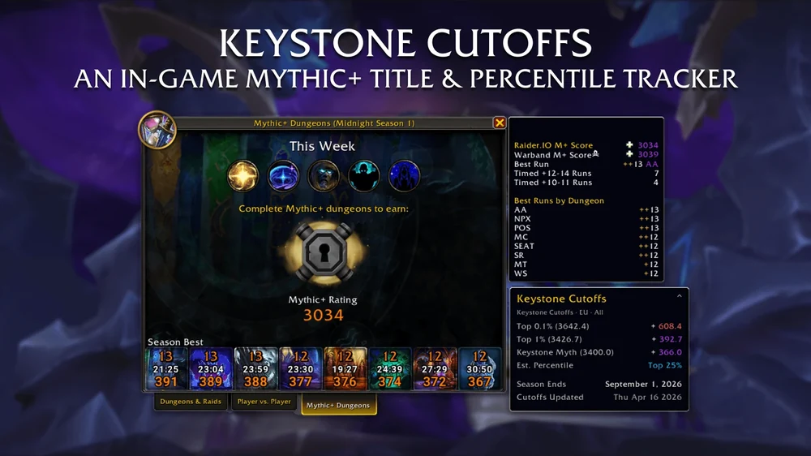
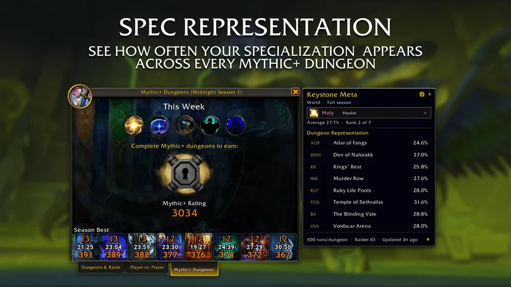

<picture>
  <source media="(prefers-color-scheme: dark)" srcset="assets/banner-dark.webp">
  <source media="(prefers-color-scheme: light)" srcset="assets/banner-light.webp">
  
</picture>

 

I'm a UI/UX and product designer from Copenhagen, with over ten years of experience building digital products. My work
is mostly about making complex things feel simple, and lately I have started building some of my own ideas as well,
all the way from the first sketch in Figma to a product people can actually download and use. This is where those
projects live.

  
  

## Projects

<table>
  <tr>
    <td colspan="2">
      
      <h3>AmberText</h3>
      
<b>A quiet place to write.</b> A free, open-source Markdown editor for Mac and Windows, with live styling,
      diagrams, maths and private AI that runs on your own computer. Every note stays a plain Markdown file.

      
<a href="https://github.com/Xtendr/AmberText">Repository</a> &nbsp;·&nbsp; <a href="https://ambertext-landing-page.vercel.app/">Landing page</a> &nbsp;·&nbsp; In development

    </td>
  </tr>
  <tr>
    <td width="50%" valign="top">
      
      <h3>Keystone Cutoffs</h3>
      
<b>Know exactly how far you are from the title.</b> A World of Warcraft addon with live Mythic+ rating
      cutoffs, updated every day.

      
<a href="https://github.com/Xtendr/KeystoneCutoffs">Repository</a> &nbsp;·&nbsp; <a href="https://www.curseforge.com/wow/addons/keystone-cutoffs">CurseForge</a>

      
    </td>
    <td width="50%" valign="top">
      
      <h3>Keystone Meta</h3>
      
<b>See what the best Mythic+ groups are playing.</b> A World of Warcraft addon that shows how often each
      specialization appears in top-ranked runs.

      
<a href="https://github.com/Xtendr/KeystoneMeta">Repository</a> &nbsp;·&nbsp; <a href="https://www.curseforge.com/wow/addons/keystonemeta">CurseForge</a>

      
    </td>
  </tr>
</table>

## What I design and build with

  
  
  
  
  

 

  Made in Copenhagen &nbsp;·&nbsp; <a href="https://nicolaibrondum.dk/">nicolaibrondum.dk</a>

